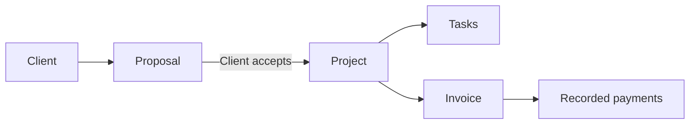

<div align="center">


# Lancelio

**A calmer workspace for independent work.**

Clients, proposals, projects, tasks, invoices and payments — connected in one place.

من أول اتفاق لآخر دفعة. مساحة واحدة ترتّب شغلك.

[English](README.md) · [العربية](docs/README.ar.md)

[](https://github.com/omarmohamed-909/Lancelio/actions/workflows/ci.yml)

**Next.js 16.4** · **React 19.3** · **TypeScript 6** · **Express 5** · **MongoDB**

[Features](#what-you-can-do) · [Preview](#a-look-inside) · [Quick start](#run-locally) · [Documentation](#explore-the-docs)

</div>

---

## Built around the way freelancers work

Lancelio connects the client relationship to the actual work and its financial records. Start with a client, agree on a proposal, track the project, issue an invoice and record what you receive.



You can also create projects directly and issue standalone invoices. Payments are recorded manually; Lancelio does not process online payments.

## What you can do

| Area                         | What is included                                                                                                                                                                      |
| ---------------------------- | ------------------------------------------------------------------------------------------------------------------------------------------------------------------------------------- |
| **Client book**              | Contact details, literal search, filters and archiving that preserves existing work.                                                                                                  |
| **Proposals**                | Priced drafts, versioned editing and expiring, revocable sharing links. Acceptance creates a project from the agreed scope.                                                           |
| **Projects & tasks**         | Project lifecycle, prioritized task boards, stable ordering, completion progress and explicit client visibility.                                                                      |
| **Invoices & payments**      | Exact monetary totals, numbered invoices, final issued snapshots, partial payments and auditable corrections.                                                                         |
| **Client portal**            | A reviewed client-facing view of projects, visible tasks and issued invoice balances, protected by revocable links.                                                                   |
| **Workspace overview**       | Real counts, task progress and invoiced, received and outstanding totals kept separate by currency.                                                                                   |
| **Work assistant**           | Natural Arabic/English conversation with Gemini or OpenAI, personalized greetings and temporary context. Product help and scoped queries also work in guided mode without a key.      |
| **Notifications & settings** | Activity inbox, individual read state, profile, password and workspace settings.                                                                                                      |
| **A familiar interface**     | Arabic/English, automatic initial language selection, RTL/LTR, light/dark appearance and responsive layouts with reduced-motion support.                                              |
| **Installable web app**      | Home-screen installation, branded icons, a bilingual offline recovery screen and updates that wait for open windows. Work records remain online-only. See [PWA details](docs/PWA.md). |

The assistant replies in the question's language, can brainstorm and draft text, and reads supported workspace data through scoped cards. It cannot create, edit, issue or send records. Intelligent conversation sends your first name, questions and limited reply excerpts to the selected provider; database records are not sent.

## A look inside

<details>
<summary><strong>Open the workspace preview · English · Dark appearance</strong></summary>


</details>

<details>
<summary><strong>Open the mobile preview · العربية · Light appearance</strong></summary>

<p align="center">
  
</p>

</details>

Screenshots use isolated demonstration/test data, including financial boundary-test values. They contain no customer records.

## Run locally

### 1. Get the project

Use **Node.js 22.20+ within Node 22**, **npm 10**, and a **MongoDB replica set** or Atlas database with transactions.

```sh
git clone https://github.com/omarmohamed-909/Lancelio.git
cd Lancelio
npm ci
```

### 2. Create local configuration

<details open>
<summary><strong>Windows · PowerShell</strong></summary>

```powershell
Copy-Item apps/api/.env.example apps/api/.env
Copy-Item apps/web/.env.example apps/web/.env.local
```

</details>

<details>
<summary><strong>macOS / Linux</strong></summary>

```sh
cp apps/api/.env.example apps/api/.env
cp apps/web/.env.example apps/web/.env.local
```

</details>

Set `MONGODB_URI` in `apps/api/.env`. Generate a signing secret and save its output as `JWT_ACCESS_SECRET` in the same file:

```sh
node -e "console.log(require('node:crypto').randomBytes(32).toString('base64url'))"
```

The frontend example points to `http://localhost:5000/api/v1`. Local environment files are ignored by Git. A standalone MongoDB server without replica-set transactions cannot run the registration workflow.

### 3. Start both apps

```sh
# Terminal 1 — API
npm run dev:api
```

```sh
# Terminal 2 — web
npm run dev:web
```

| Service            | Local address                                                                   |
| ------------------ | ------------------------------------------------------------------------------- |
| Web app            | [localhost:3000](http://localhost:3000)                                         |
| API liveness       | [localhost:5000/api/v1/health](http://localhost:5000/api/v1/health)             |
| Database readiness | [localhost:5000/api/v1/health/ready](http://localhost:5000/api/v1/health/ready) |

Optional assistant providers and email delivery are configured on the server. Guided assistant mode needs no external key. See the [development guide](docs/DEVELOPMENT.md) for configuration and troubleshooting.

## Under the hood

```text
Lancelio/
├── apps/
│   ├── web/       Next.js routes, feature UI, shared components and localization
│   └── api/       Express delivery, application use cases and MongoDB adapters
├── docs/          Product contracts, design decisions and release runbooks
└── tools/         Architecture guards, localization checks and release tooling
```

The API is a modular monolith with inward-facing dependencies: **HTTP → application → domain**. Workspace scope, version checks, transactions and exact monetary rules are enforced on the server. Read the [architecture](docs/ARCHITECTURE.md) and [API contract](docs/API.md) for the details.

## Quality & verification

| Command                    | Purpose                                                                               |
| -------------------------- | ------------------------------------------------------------------------------------- |
| `npm run check`            | Formatting, lint, architecture, localization, types, API tests and production builds. |
| `npm run test:e2e`         | Isolated browser journeys; responsive audits also run on Firefox and WebKit.          |
| `npm run test:responsive`  | Responsive, orientation, keyboard and accessibility checks.                           |
| `npm run test:release`     | Local production HTTPS journey and session/cookie checks.                             |
| `npm run test:api-startup` | Compiled API startup, authentication and database readiness checks.                   |
| `npm run test:backup`      | Encrypted backup and restore drills against an isolated database.                     |

Browser and release checks require additional local tools. Follow the [verification setup](docs/DEVELOPMENT.md#verification) before running them. Integration/browser tests use temporary databases, not the configured application database.

## Release status

Core workflows are implemented and the repository includes CI and release tooling. **Hosted activation is still pending**: real email delivery, production routing and rate limits, scheduled offsite backups and physical-device checks must be verified before public launch.

The deployment topology is **Vercel frontend + Vercel Express API**. An optional Vercel Daemon processes recovery email when delivery is enabled. Use the [release runbook](docs/RELEASE.md) for project settings, environment variables, worker activation, backups and rollback. [`render.yaml`](render.yaml) remains an alternative persistent API configuration.

## Explore the docs

Google sign-in is prepared as an optional integration, with onboarding and direct account linking for verified Gmail and Google Workspace identities. Enable it with the API's `GOOGLE_CLIENT_ID`: [Google sign-in setup](docs/GOOGLE_SIGN_IN.md). Optional bilingual welcome messages and the separate Google identity setup are documented in [welcome email setup](docs/WELCOME-EMAIL.md).

| Guide                                                                                                                        | Start here for                                                         |
| ---------------------------------------------------------------------------------------------------------------------------- | ---------------------------------------------------------------------- |
| [Development](docs/DEVELOPMENT.md)                                                                                           | Environment, local tools, test setup and common issues.                |
| [Assistant](docs/ASSISTANT.md)                                                                                               | Supported questions, Gemini/OpenAI configuration and assistant limits. |
| [Design](docs/DESIGN.md)                                                                                                     | Visual identity, motion, shared controls and bilingual behavior.       |
| [Architecture](docs/ARCHITECTURE.md) · [API](docs/API.md)                                                                    | Module boundaries, data flows and HTTP contracts.                      |
| [Responsive verification](docs/RESPONSIVE.md)                                                                                | Browser/device coverage and physical-device limits.                    |
| [Profile](docs/PROFILE.md) · [Account security](docs/ACCOUNT-SECURITY.md) · [Workspace settings](docs/WORKSPACE-SETTINGS.md) | Settings behavior and verification.                                    |
| [Release](docs/RELEASE.md) · [Backlog](docs/BACKLOG.md)                                                                      | Deployment preparation, operational work and remaining tasks.          |

---

<p align="center"><strong>A place for the details. Room for the work.</strong><br />Lancelio · مساحة لشغلك، على طريقتك.</p>
