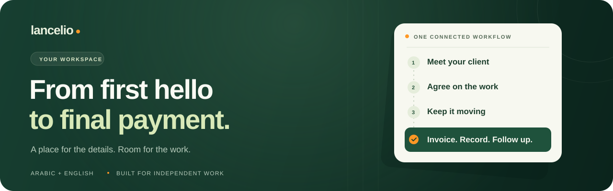
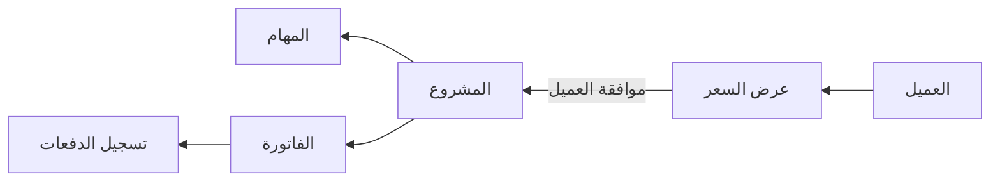
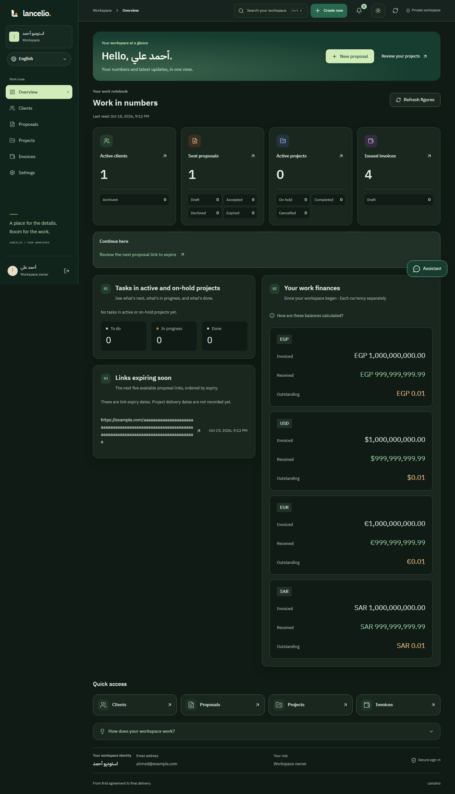
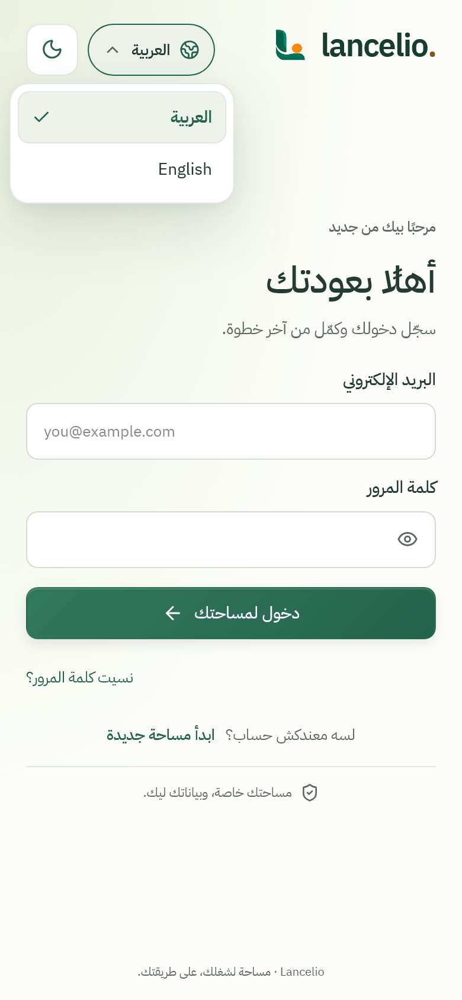

<div align="center">



# Lancelio

**مساحة واحدة ترتّب شغلك كفريلانسر.**

عملاؤك، عروض الأسعار، المشاريع، المهام، الفواتير والدفعات — في مكان واحد.

[English](../README.md) · [العربية](README.ar.md)

[](https://github.com/omarmohamed-909/Lancelio/actions/workflows/ci.yml)

**Next.js 16.4** · **React 19.3** · **TypeScript 6** · **Express 5** · **MongoDB**

</div>

---

## من أول عميل لآخر دفعة

Lancelio بيربط التعامل مع العميل بالشغل المتفق عليه وحساباته: ضيف العميل، جهّز عرض السعر، تابع المشروع والمهام، أصدر الفاتورة وسجّل اللي استلمته.



تقدر كمان تنشئ مشروع مباشرة أو فاتورة مستقلة. الدفعات بتتسجل يدويًا؛ الموقع مش بوابة دفع إلكتروني.

## المميزات

| القسم                    | المتاح                                                                                                                     |
| ------------------------ | -------------------------------------------------------------------------------------------------------------------------- |
| **دفتر العملاء**         | بيانات التواصل، البحث، الفلاتر والأرشفة مع الحفاظ على الشغل المرتبط بالعميل.                                               |
| **عروض الأسعار**         | بنود وأسعار دقيقة، تعديل المسودات وروابط مشاركة بصلاحية محددة وإمكانية الإلغاء. قبول العرض بينشئ مشروعًا مرتبطًا بالاتفاق. |
| **المشاريع والمهام**     | حالات المشروع، أولويات وترتيب المهام، نسبة الإنجاز وتحديد المهام اللي تظهر للعميل.                                         |
| **الفواتير والدفعات**    | حسابات دقيقة، ترقيم الفواتير، نسخة نهائية عند الإصدار، دفعات جزئية وتصحيح الدفعات مع الاحتفاظ بالسجل.                      |
| **بوابة العميل**         | معاينة ومشاركة المشاريع والمهام المسموح بعرضها وأرصدة الفواتير، من خلال رابط قابل للإلغاء.                                 |
| **لوحة المتابعة**        | أرقام فعلية للشغل والمستحقات والمقبوض، مع فصل حساب كل عملة.                                                                |
| **مساعد الشغل**          | شرح الموقع والبحث عن المشاريع والأرصدة. وضع إرشادي بدون مفتاح، وتكامل اختياري لـGemini أو OpenAI لفهم الأسئلة.             |
| **الإشعارات والإعدادات** | سجل نشاط، حالة قراءة لكل عضو، وإعدادات الحساب والأمان ومساحة العمل.                                                        |
| **تجربة الاستخدام**      | عربي وإنجليزي، اختيار أولي حسب لغة الجهاز، RTL/LTR، فاتح وداكن، وشاشات متجاوبة تراعي تقليل الحركة.                         |

المساعد بيرد بلغة السؤال، ويقدر يشرح ويقرأ البيانات المدعومة من مساحتك. إنشاء وتعديل وإصدار وإرسال السجلات من خلاله لسه مش متاح.

## نظرة على الواجهة

<details>
<summary><strong>لوحة المتابعة · English · المظهر الداكن</strong></summary>



</details>

<details>
<summary><strong>الموبايل · العربية · المظهر الفاتح</strong></summary>

<p align="center">
  
</p>

</details>

الصور من بيانات تجريبية معزولة، ومنها قيم لاختبار دقة الحسابات المالية؛ مفيهاش بيانات عملاء حقيقيين.

## تشغيل المشروع

### ١. المتطلبات والتثبيت

محتاج **Node.js من 22.20 داخل إصدار 22**، و**npm 10**، وقاعدة **MongoDB replica set** أو Atlas تدعم المعاملات.

```sh
git clone https://github.com/omarmohamed-909/Lancelio.git
cd Lancelio
npm ci
```

### ٢. إعداد ملفات البيئة

في PowerShell على Windows:

```powershell
Copy-Item apps/api/.env.example apps/api/.env
Copy-Item apps/web/.env.example apps/web/.env.local
```

على macOS أو Linux استخدم `cp` بدل `Copy-Item`.

حط رابط قاعدة البيانات في `MONGODB_URI` داخل `apps/api/.env`. ولتوليد قيمة `JWT_ACCESS_SECRET` محليًا:

```sh
node -e "console.log(require('node:crypto').randomBytes(32).toString('base64url'))"
```

احفظ الناتج في نفس ملف البيئة. الملفات المحلية دي مستبعدة من Git. قاعدة MongoDB المنفردة بدون replica set مش هتشغّل معاملة إنشاء الحساب.

### ٣. تشغيل الواجهة والـAPI

في طرفية أولى:

```sh
npm run dev:api
```

وفي طرفية تانية:

```sh
npm run dev:web
```

| الخدمة            | الرابط المحلي                                                                   |
| ----------------- | ------------------------------------------------------------------------------- |
| الموقع            | [localhost:3000](http://localhost:3000)                                         |
| حالة تشغيل الـAPI | [localhost:5000/api/v1/health](http://localhost:5000/api/v1/health)             |
| جاهزية القاعدة    | [localhost:5000/api/v1/health/ready](http://localhost:5000/api/v1/health/ready) |

المساعد الإرشادي مش محتاج مفتاح خارجي. إعداد Gemini/OpenAI والبريد بيكون في السيرفر. التفاصيل في [دليل التطوير](DEVELOPMENT.md).

## تنظيم المشروع

```text
Lancelio/
├── apps/
│   ├── web/       واجهة Next.js والمميزات والمكونات والترجمة
│   └── api/       واجهة Express وحالات الاستخدام وربط MongoDB
├── docs/          العقود والتصميم وخطة الإطلاق
└── tools/         فحوص البنية والترجمة وأدوات الإصدار
```

الـAPI مقسّم لوحدات داخل تطبيق واحد، والاعتماد بيتجه من HTTP لحالات الاستخدام ثم قواعد الدومين. السيرفر مسؤول عن حدود مساحة العمل، والتحقق من النسخ، والمعاملات ودقة الحسابات.

## فحوص الجودة

| الأمر                      | وظيفته                                                                    |
| -------------------------- | ------------------------------------------------------------------------- |
| `npm run check`            | التنسيق وlint والبنية والترجمة والأنواع واختبارات الـAPI وبناء التطبيقين. |
| `npm run test:e2e`         | رحلات المتصفح المعزولة، وفحوص التجاوب على Firefox وWebKit أيضًا.          |
| `npm run test:responsive`  | الشاشات والاتجاه والكيبورد وإتاحة الاستخدام.                              |
| `npm run test:release`     | رحلة نسخة الإنتاج محليًا عبر HTTPS وفحوص الجلسات.                         |
| `npm run test:api-startup` | تشغيل الـAPI المبني والتحقق من الدخول وجاهزية القاعدة.                    |
| `npm run test:backup`      | تجربة النسخ المشفّر والاسترجاع على قاعدة معزولة.                          |

فحوص المتصفح والإصدار محتاجة أدوات إضافية؛ راجع [إعداد الاختبارات](DEVELOPMENT.md#verification). الاختبارات المعزولة مش بتستخدم قاعدة بيانات التطبيق المُعدّة عندك.

## حالة الإطلاق

الوظائف الأساسية موجودة، وCI وأدوات تجهيز الإصدار مضافة. **التفعيل على الاستضافة لسه ما اكتملش**: لازم التحقق من إرسال البريد الحقيقي، والتوجيه وحدود الطلبات، وتشغيل النسخ الاحتياطي خارج السيرفر، وتجربة الأجهزة الحقيقية قبل الإطلاق العام.

التوزيع المخطط: واجهة على **Vercel** مع **خدمة Node مستمرة للـAPI**. ملف [`render.yaml`](../render.yaml) مثال إعداد، مش خدمة مفعّلة. التفاصيل في [خطة الإصدار](RELEASE.md).

## التوثيق

| الدليل                                                                                                     | محتواه                                              |
| ---------------------------------------------------------------------------------------------------------- | --------------------------------------------------- |
| [التطوير](DEVELOPMENT.md)                                                                                  | ملفات البيئة والأدوات والاختبارات والمشاكل الشائعة. |
| [المساعد](ASSISTANT.md)                                                                                    | الأسئلة المدعومة وإعداد التكامل وحدود المساعد.      |
| [التصميم](DESIGN.md)                                                                                       | الهوية والحركة والمكونات ودعم اللغتين.              |
| [البنية](ARCHITECTURE.md) · [الـAPI](API.md)                                                               | تقسيم الوحدات والعقود وتدفق البيانات.               |
| [التجاوب](RESPONSIVE.md)                                                                                   | تغطية المتصفحات وحدود فحص الأجهزة.                  |
| [الملف الشخصي](PROFILE.md) · [أمان الحساب](ACCOUNT-SECURITY.md) · [إعدادات المساحة](WORKSPACE-SETTINGS.md) | سلوك الإعدادات وفحوصها.                             |
| [الإصدار](RELEASE.md) · [قائمة العمل](BACKLOG.md)                                                          | تجهيز النشر والتشغيل والمهام المتبقية.              |

---

<p align="center"><strong>مكان للتفاصيل. ومساحة للشغل.</strong><br />Lancelio · مساحة لشغلك، على طريقتك.</p>
